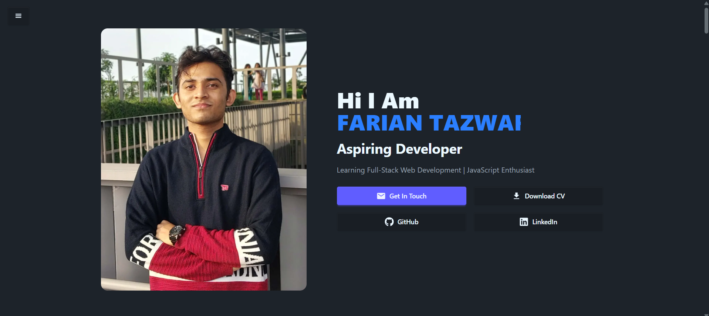
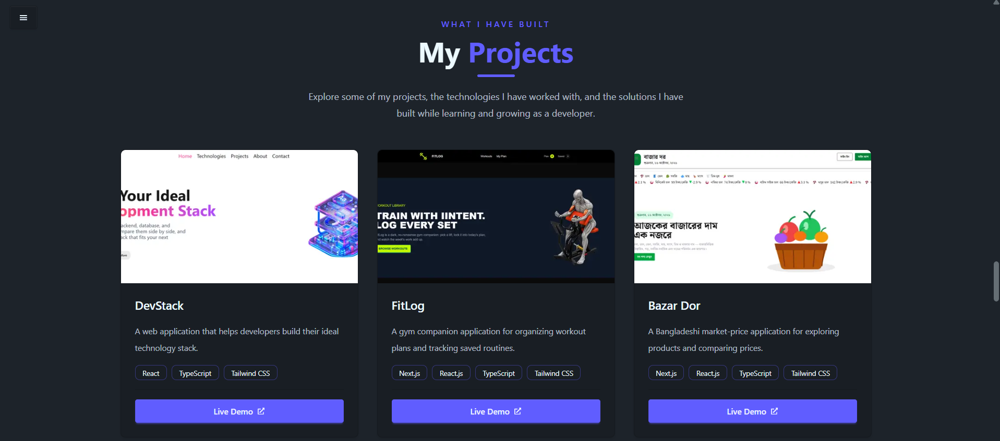
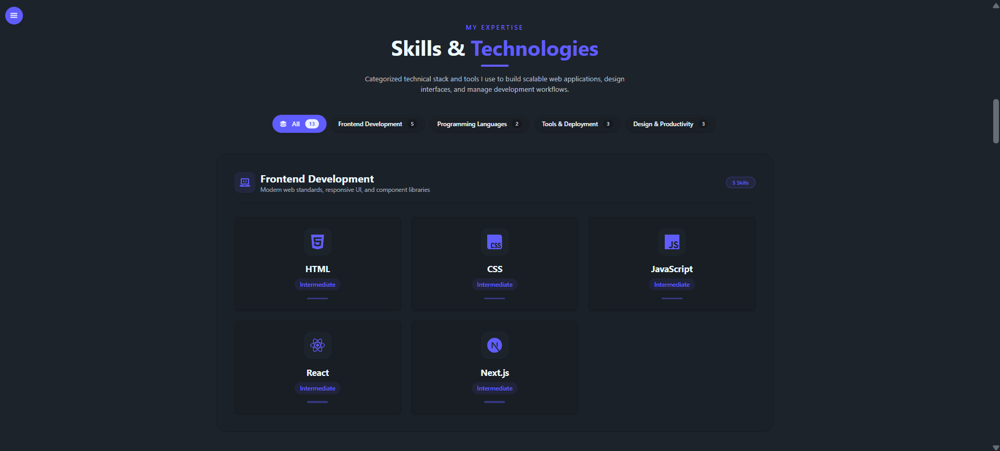

# ✨ My Personal Portfolio

Welcome to my personal portfolio website's repo! This website showcases my skills, education, certificates, projects, and volunteer experiences.

## 👨‍💻 About Me

I'm a Computer Science and Engineering student at **BRAC University**, currently learning Full-Stack Web Development. I enjoy exploring new technologies, building projects, and continuously improving my skills.

## 🛠️ Technologies

- Next.js
- React
- TypeScript
- Tailwind CSS
- DaisyUI
- React Icons

## ✨ Features

- Responsive design for all devices
- About Me section
- Skills and education
- Certificates and projects
- Volunteer experience
- Contact information and social links

## 📸 Screenshots

| Home | Projects | Skills |
|------|----------|--------|
|  |  |  |

## 🌐 Connect With Me

- **Portfolio:** [Visit My Website](https://farian-portfolio-theta.vercel.app/)
- **GitHub:** [@farian2006](https://github.com/farian2006)
- **LinkedIn:** [Farian Tazwar](https://www.linkedin.com/in/farian-tazwar/)
- **Email:** [fariantazwar@gmail.com](mailto:fariantazwar@gmail.com)

---

> Learn. Build. Improve. Repeat.

⭐ Thanks for visiting my repository!

## License
This project is All Rights Reserved. See the LICENSE file for details.
